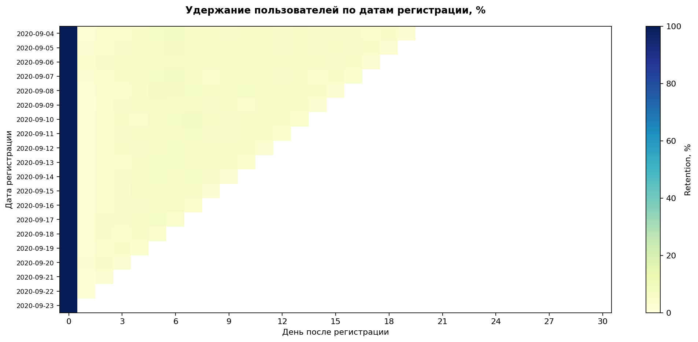
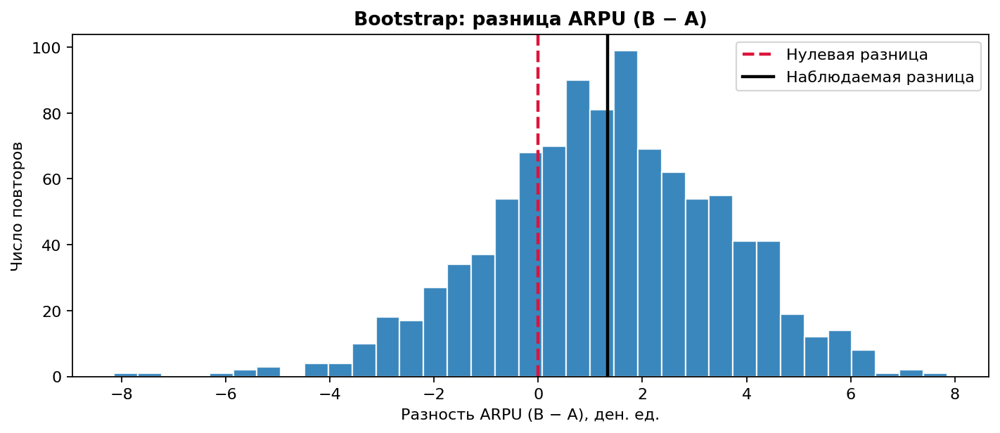
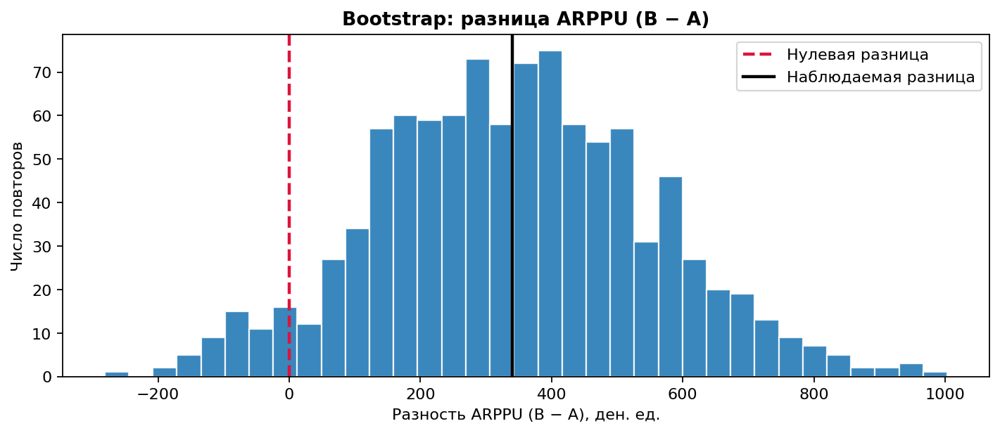

<div align="center">

# Game Analytics

### Когортный анализ · A/B-тестирование · Метрики игровых событий


Анализ удержания и монетизации мобильной игры

[Тетрадка с результатами](game_analytics_portfolio_full.ipynb) · [Таблицы и графики](full_results/)

</div>

---

## О проекте

Проект объединяет три задачи продуктовой аналитики: расчет дневного retention, сравнение двух наборов акционных предложений и разработку системы метрик тематического игрового события.

В Jupyter Notebook представлены постановки задач, формулы, обработка данных, статистические проверки, графики и выводы. Расчеты выполнены по полным таблицам. Результаты и визуализации сохранены внутри тетрадки и отдельными файлами.

| Удержание | A/B-тест | Игровые события |
| :--- | :--- | :--- |
| 1 000 000 игроков | 404 770 пользователей | Прохождение и награды |
| 9 601 013 авторизаций | CR, ARPU, ARPPU | Удержание и монетизация |
| 5 110 дневных когорт | z-тест и bootstrap | Сложность и откаты прогресса |

## 01. Когортный анализ удержания

**Задача:** рассчитать retention по дням после регистрации и представить результаты в виде когортной матрицы.

Когорта определяется датой регистрации в UTC. Retention показывает долю игроков когорты, активных в конкретный календарный день после регистрации. Повторные входы одного игрока в течение дня учитываются однократно. Знаменатель включает всех зарегистрированных игроков когорты.

Функция `calculate_retention` объединяет регистрации и авторизации по `uid`, рассчитывает день жизни игрока и формирует матрицу для дней от D0 до D30. Дни за пределами наблюдения обозначаются `NaN`.

**Результат:** матрица из 5 110 когорт и 31 дня жизни. D0 равен 100%: первая авторизация каждого игрока совпадает со временем регистрации.



На графике представлены последние 20 когорт, зарегистрированных с 04.09.2020 по 23.09.2020. Пустые области соответствуют еще не наблюдавшимся дням; D30 для этих когорт не наступил. Последний день журнала заканчивается в 15:17:24 UTC и представлен частично.

[Полная матрица retention](full_results/retention_matrix.csv)

## 02. A/B-тест монетизации

**Задача:** сравнить контрольный набор предложений A и тестовый набор B по конверсии и выручке на пользователя.

| Метрика | Определение | Метод сравнения |
| --- | --- | --- |
| CR | Доля пользователей с положительной выручкой | Двусторонний z-тест двух пропорций |
| ARPU | Средняя выручка на пользователя | Bootstrap разности средних B минус A |
| ARPPU | Средняя выручка на платящего пользователя за период | Bootstrap разности средних B минус A |

При выражении CR долей от 0 до 1 выполняется равенство `ARPU = CR × ARPPU`. Денежные метрики представлены в единицах поля `revenue`.

### Результаты

| Показатель | Контроль A | Тест B |
| --- | ---: | ---: |
| Пользователи | 202 103 | 202 667 |
| Платящие пользователи | 1 928 | 1 805 |
| Суммарная выручка | 5 136 189 | 5 421 603 |
| CR, % | 0,95397 | 0,89062 |
| ARPU | 25,41 | 26,75 |
| ARPPU | 2 664,00 | 3 003,66 |

Конверсия в B ниже на **0,06335 процентного пункта**. Двусторонний z-тест дает **p = 0,03503**. Различие значимо при номинальном уровне 0,05 без поправки на множественные сравнения.

| Метрика | Разность B минус A | 95%-й bootstrap-интервал |
| --- | ---: | --- |
| ARPU | 1,34 | [−3,14; 5,58] |
| ARPPU | 339,66 | [−71,82; 761,72] |

Bootstrap включает 1 000 повторов с `random_state=42`. Оба доверительных интервала включают ноль. Наблюдаемый рост ARPU и ARPPU не получил статистического подтверждения.

<details>
<summary>Графики bootstrap-разностей</summary>





Красная пунктирная линия обозначает нулевую разность, черная линия наблюдаемую разность B минус A.

</details>

**Вывод:** преимущество тестового набора B не подтверждено; снижение CR представляет дополнительный риск. Рекомендация по результатам анализа: сохранить контрольный набор A.

[Метрики по группам](full_results/ab_metrics.csv) · [Доверительные интервалы](full_results/bootstrap_summary.csv) · [Bootstrap-разности](full_results/bootstrap_differences.csv)

## 03. Метрики игровых событий

**Задача:** определить систему показателей тематического события с уровнями и наградами, затем дополнить ее для механики отката после поражения.

| Область оценки | Показатели |
| --- | --- |
| Охват | Участники и их доля среди игроков с доступом к событию |
| Прохождение | Доля завершивших, уникальные пройденные уровни, максимальный достигнутый этап |
| Награды | Получение финальной награды, распределение предметов и бонусов |
| Активность и удержание | Попытки, активные сессии, игровые дни, D1 и D7 после окончания события |
| Монетизация | ARPU, CR, ARPPU, выручка и покупки за одинаковый период |
| Механика отката | Неудачи, частота и глубина откатов, застревание, прекращение участия и чистый прогресс |

Для оценки прохождения основной показатель представляет долю участников, завершивших событие. В версии с откатами оценка дополняется глубиной потери прогресса и прекращением участия после поражений.

**Результат:** определены метрики базового события и версии с откатами, знаменатели и окна наблюдения. Для оценки причинного эффекта используется сравнение рандомизированных групп игроков с доступом к событию.

## Данные

| Файл | Строки | Поля |
| --- | ---: | --- |
| `data/problem1-reg_data.csv` | 1 000 000 | `reg_ts`, `uid` |
| `data/problem1-auth_data_part*.csv` | 9 601 013 | `auth_ts`, `uid` |
| `data/problem2.csv` | 404 770 | `user_id`, `revenue`, `testgroup` |

Время регистрации и авторизации задано в Unix-секундах. В A/B-таблице одна строка соответствует одному пользователю за период эксперимента. Во всех расчетах используются полные таблицы, `USE_SAMPLE=False`. Журнал авторизаций разделен на семь CSV с заголовком `auth_ts;uid`. Тетрадка читает все части последовательно без предварительного объединения.

## Структура проекта

```text
game-analytics/
├── README.md
├── game_analytics_portfolio_full.ipynb
├── requirements.txt
├── .gitignore
├── data/
│   ├── problem1-reg_data.csv
│   ├── problem1-auth_data_part01.csv
│   ├── problem1-auth_data_part02.csv
│   ├── problem1-auth_data_part03.csv
│   ├── problem1-auth_data_part04.csv
│   ├── problem1-auth_data_part05.csv
│   ├── problem1-auth_data_part06.csv
│   ├── problem1-auth_data_part07.csv
│   └── problem2.csv
└── full_results/
    ├── retention_matrix.csv
    ├── retention_heatmap.png
    ├── ab_metrics.csv
    ├── bootstrap_summary.csv
    ├── bootstrap_differences.csv
    ├── bootstrap_arpu.png
    ├── bootstrap_arppu.png
    └── run_coverage.csv
```

## Запуск

Среда выполнения: Python 3.12.6. Команды выполняются из корня проекта; входные CSV располагаются в `data/`.

```bash
python -m pip install -r requirements.txt
jupyter notebook game_analytics_portfolio_full.ipynb
```

Параметры расчета: горизонт retention от 0 до 30 дней, `N_BOOTSTRAP=1000`, `RANDOM_STATE=42`, `ALPHA=0.05`. Тетрадка содержит сохраненные результаты всех вычислений и три графика.

Установка и запуск Jupyter описаны в [официальной документации](https://github.com/jupyter/notebook#installation).

## Инструменты
`Python` · `pandas` · `NumPy` · `Matplotlib` · `statsmodels` · `Jupyter Notebook`

Этот проект выполнен в рамках учебного задания на платформе [Karpov.Courses](https://karpov.courses). 
* **Автор задания:** ООО «Карпов Курсы»
* **Официальный сайт:** [karpov.courses](https://karpov.courses)
